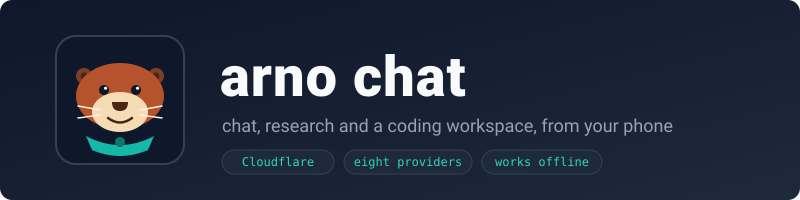
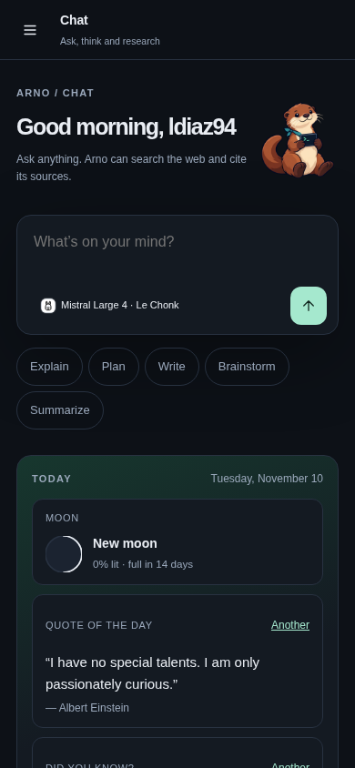
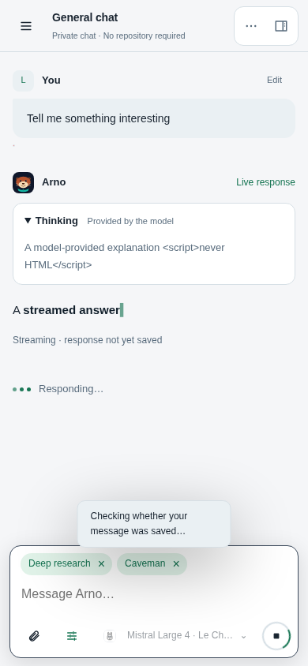
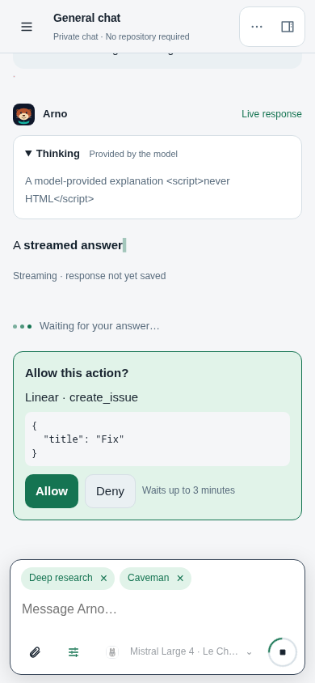
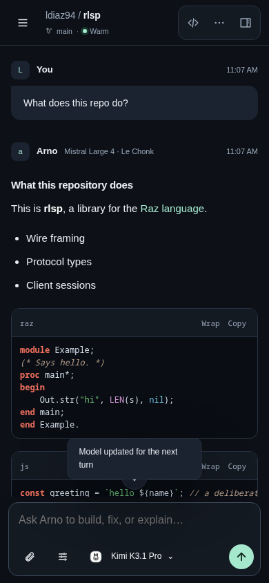
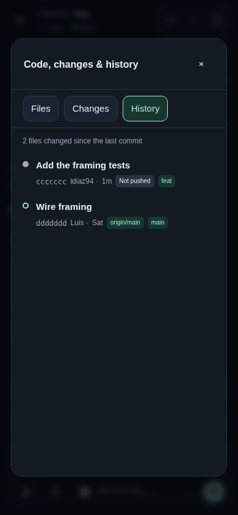
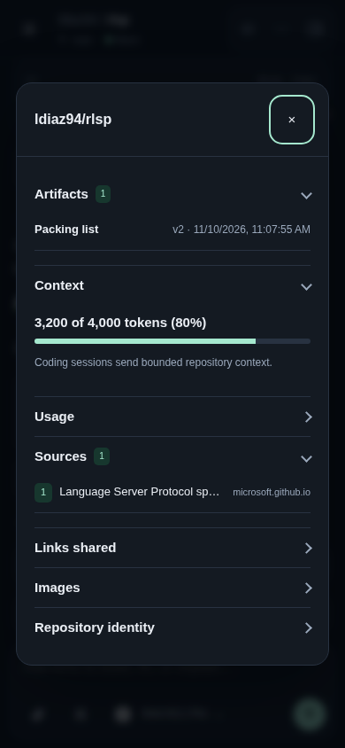

<p align="center">
  
</p>

Arno Chat is a chat app and a coding workspace you can carry in your
pocket. In a **chat** you talk to a language model of your choice, which
can search the web, read pages, write documents and use the services you
connect. In a **coding session** the model works on one of your GitHub
repositories, in a container of its own in the cloud: it reads the code,
runs the tests, edits, commits and pushes, while you watch from a phone or
a browser. It installs as an app, works offline, and runs entirely on
Cloudflare: a Worker, Durable Objects and Containers, with no server of its
own to look after.

The name is [arno](https://github.com/ldiaz94/arno)'s, the coding agent
every session runs, with "chat" for what you do with it. The mascot is
arno's too: a river otter, a small, practical animal that fetches things
and brings them back, in a teal scarf ([brand/UPSTREAM.md](brand/UPSTREAM.md)
says where the artwork comes from).

## See it

<p align="center">
  
  
  
</p>
<p align="center">
  
  
  
</p>

The pictures come from the design test's fixed data (`npm run
screenshots`), so they show the app as the tests see it.

## Get it

You need a Cloudflare account with Workers Paid (for Containers), Docker,
Node 20 or later, and a GitHub App or OAuth app for signing in. Chats check
the pages they make in Browser Rendering (the `BROWSER` binding): Workers
Paid includes 10 browser hours a month, then $0.09 an hour.

```sh
npm install
npx wrangler login
npx wrangler secret put GITHUB_CLIENT_ID          # the GitHub app signing in
npx wrangler secret put GITHUB_CLIENT_SECRET
npx wrangler secret put ACCOUNT_ENCRYPTION_KEY    # 32 random bytes, base64
npx wrangler secret put OLLAMA_API_KEY            # optional: a shared Ollama Cloud key
npm test                                          # lint, format and unit tests
npm run deploy                                    # deploys, recording the commit
```

`wrangler.jsonc` names the Worker, its Durable Object, the pinned runner
image and who may sign in (`ALLOWED_GITHUB_LOGINS`). The runner image is
built from `runner/Dockerfile` with arno compiled on the host; to update
arno in it, see [doc/OPERATIONS.md](doc/OPERATIONS.md#runner-image).
Every secret, setting and recovery step is in that guide.

## Learn it

Sign in with GitHub. The **Chat | Code** switch at the top of the sidebar
chooses the mode; each has its own home page and list of conversations,
the most recently active first.

| Where | What it does |
| --- | --- |
| Chat home, **New chat** | A conversation with web research, artifacts and your connected MCP tools; no container |
| Code home, a repository's **Open** | A new coding session: a clone of the repository in a container of its own |
| ◐ | Theme: dark or light, and a palette (Arno, Duck, Catppuccin, Cyberpunk, Phosphor, Gruvbox), kept on this device |
| ⋯ | The repository's actions (changes and pull request, pull, a new session on it) and the conversation's (rename, export, delete) |
| ⋯ → **Continue in a coding session** (a chat) | Pick a repository; the new session opens with the chat in its message box (its latest turns, up to 7,000 characters) |
| ↻ beside Edit | Refresh the conversations (also on coming back to the app after 30 s) |
| ⋯ → **Add a repository** (coding) | Clone another beside the project, at /workspace/<name> (e.g. ldiaz94/raz at /workspace/raz); arno may edit, commit and push it when asked. Remembered for the project's repository: later sessions on it get it too. Tap it under *Also checked out* to take it out |
| ⋯ → **New session on this repository** | Another session on the same repository, from its current branch |
| The title | Conversation details: artifacts, context, usage and cost, sources, links, images |
| An artifact's card | The artifact beside the chat: a document, an HTML page that runs, a drawing, a diagram, a code file; its source, what each version changed, restore, download |
| **Artifacts** in the sidebar | Every conversation's artifacts, searchable, by kind |
| `</>` | The session's files, its changes, and its commit history |
| Model button | The model for this conversation, from every provider you have a key for |
| Ring and $ beside the model | How full the model's context is and what the conversation has cost; on a phone they take turns (Settings → You → Display changes this). A tap opens the details |
| Settings → You → **Display** | Composer meters (alternating, side by side, one, none), model thinking (folded, open, hidden), time, tokens and cost under answers, conversation width, whether the view follows a streaming answer, and whether Save preferences closes Settings; kept with the account |
| Settings → You → **Memory** | Who saves facts about you for later chats: only when you ask ("remember that …", the default), the model on its own too, or off; each memory listed by title, opening to its fact and Forget |
| Sliders button | This conversation's options (below) |
| **Edit** in the sidebar | Select conversations and delete them together |
| **Search conversations** in the sidebar, `/` or Ctrl/⌘+Shift+F | Every chat and coding session by what was said: titles, your messages, answers, artifact titles. Fuzzy (letters in order, one typo in a long word, accents ignored), every word must match; a result opens at the turn it quotes. Works offline; Escape clears |
| You → About | The version the device runs, the server's build, Check for updates |

**Options**, kept per conversation (the sliders button):

| Option | Choices | In |
| --- | --- | --- |
| Web search | on, off | both |
| Mode | Standard; Fast (short, no thinking); Deep research (a cited report saved as an artifact) | Deep research in chats |
| Thinking | Auto, Off, Low, Medium, High (where the model's provider supports it) | both |
| Style | Normal, Concise, Caveman | both |
| Super search | on, off: more searches, page reads and model calls for one turn (25, 50, 32 instead of 6, 12, 12); chat turns have no time limit | chats |
| MCP tools | on, off (your connections marked *Use in chats*) | chats |
| Approach | Auto, Pair, Build, Review (arno's mode) | coding |
| Workers side by side | Off, 1, 2, 4 | coding |
| Budget per message | Auto, $1, $3, $10, or any amount with `/budget` | coding |

**Slash commands** in a coding session; typing `/` lists them:

| Command | What it does |
| --- | --- |
| `/compact [focus]` | Summarize the conversation and go on from the summary |
| `/clear`, `/new` | Trim the history to the first exchange; start a new conversation |
| `/usage` | Requests, tokens, cache savings and cost of the session |
| `/notes`, `/remember`, `/forget`, `/my-memory` | The model's notes on the project; facts kept across conversations |
| `/test [command]` | Run the project's tests; a failure goes to the model |
| `/tools`, `/mcp`, `/system`, `/list`, `/load`, `/help` | What arno offers, its MCP servers, its system prompt, other conversations |
| `/pull` | Bring GitHub's new commits on the branch into the session (also **Pull** in the History tab) |
| `/open [name]` | Open an artifact (arno's, in a coding session), the newest if none is named |
| `/mode`, `/budget`, `/workers` | Set this conversation's options, as the sliders do |

In a session the model can `git push` when you ask it to (it never commits
or pushes on its own): the clone's origin goes through the Worker, which adds
your GitHub token on the way out. **Changes** show only what GitHub does not
have yet, so pushed work, pulled work and other sessions' pushes stay out of
them. The Changes tab's **Pull request…** opens a pull request from exactly
what you reviewed, on a new branch, instead.

**Settings** (your name, bottom left) hold provider keys (Ollama Cloud,
OpenAI, Anthropic, Gemini, DeepSeek, Kimi, Mistral, Meta), instructions and
skills, MCP connections (a token, or **Sign in** with OAuth), your own
SearXNG, a Cloudflare API token for `wrangler deploy` in sessions, full
internet for sessions, notifications, and the home page's Today card.

## How it works

Seven ideas, a module or a folder each. Read them in this order.

**1. The pages are plain files.** [`web/`](web/) is the whole app the
browser runs: ES modules with no framework and no build step, served as
static assets by Cloudflare. [`web/app.js`](web/app.js) wires them;
[`web/core.js`](web/core.js) holds the shared state; each other module owns
one part of the screen (the thread, the sidebar, the code dialog, the
options). Logic that needs no page lives in `.mjs` files, so the unit tests
run it in Node. HTML is built as escaped strings ([`web/render.mjs`](web/render.mjs)
renders Markdown safely, in answers and your own messages, and colours
it in the message box as you type; [`web/highlight.mjs`](web/highlight.mjs) colours code
after [ladle](https://github.com/ldiaz94/ladle)'s design).

**2. One Worker, routes as tables.** [`server/worker.js`](server/worker.js)
takes every request the static files do not answer: sign-in under `/auth/`
([`server/auth.mjs`](server/auth.mjs)), the account's routes
([`server/api.mjs`](server/api.mjs)) and one conversation's
([`server/sessions-api.mjs`](server/sessions-api.mjs)). Each is a table from
`METHOD /path` to a handler, so a reader finds a route by searching for it.

**3. A conversation is a Durable Object.** [`server/probe/probe.mjs`](server/probe/probe.mjs)
is the one Durable Object class; its name chooses its role: a conversation
(`code:<user>:<id>`), a user's list and profile, or a sign-in. A
conversation keeps its turns, its job and its files in its own storage,
and runs each turn from an alarm, so closing the page never stops one.
Its methods come in groups: the live view ([`live.mjs`](server/probe/live.mjs)),
the records ([`records.mjs`](server/probe/records.mjs)), and the turns below.

**4. A chat is a tool loop on the server.** [`server/chat/turn.mjs`](server/chat/turn.mjs)
asks the model ([`chat.mjs`](server/chat/chat.mjs), one adapter for every
provider's streaming API) and runs the tools it calls: web research
([`research.mjs`](server/chat/research.mjs)), artifacts, and the MCP tools
of the connections you marked for chats ([`chat-mcp.mjs`](server/chat/chat-mcp.mjs)).
A tool that may change something waits for you to tap **Allow**.
[`plan.mjs`](server/chat/plan.mjs) turns the options into budgets and limits.
Each HTML page the model writes is opened in a headless browser at phone
size ([`render.mjs`](server/probe/render.mjs)); its errors, failed loads and
a screenshot go back to the model. Before it answers, a reviewer (the
**Review model** in Settings → You, or the chat's own model) gets your
request, the page's source and screenshots at phone size and 1280×800
([`review.mjs`](server/chat/review.mjs)); the defects it lists go back to
the model to fix. The review costs one extra call per page. `check_artifact` can set a slider, tap or drag
before the screenshot, to see another state without changing the page. An answer that says a page changed when nothing
was written is sent back. `find_image` ([`images.mjs`](server/chat/images.mjs))
finds freely licensed pictures on Wikimedia Commons for pages to show.
`remember`, `recall` and `forget` ([`memory.mjs`](server/chat/memory.mjs))
keep facts about you like a small library: every chat sees their titles
and reads the facts it needs; Settings → You → Memory says whether the
model may save them on its own.

**5. A coding session is a container driven by arno.** [`server/code/turn.mjs`](server/code/turn.mjs)
starts the session's container, or restores it from its snapshot
([`workspace.mjs`](server/code/workspace.mjs)), and gives your message to
`arno --serve`, speaking its protocol ([`serve.mjs`](server/code/serve.mjs)).
arno works on a copy of the project, runs workers side by side, and its
changes are applied when the turn ends; the app answers every question it
asks, since the container is the sandbox. Then the diff, a snapshot, and
the turn is saved.

**6. Credentials never enter the container.** The container has no
internet of its own. It reaches the world through gateways in the Worker,
which add the credentials on the way out: the models
([`server/gateways/model.mjs`](server/gateways/model.mjs)), MCP servers
([`mcp.mjs`](server/gateways/mcp.mjs), with OAuth sign-in in
[`mcp-oauth.mjs`](server/gateways/mcp-oauth.mjs)), git for the session's own
repository ([`server/code/git.mjs`](server/code/git.mjs)), npm and PyPI, and
Cloudflare's API ([`server/code/sandbox.mjs`](server/code/sandbox.mjs)).
Secrets at rest are sealed per account and per field
([`server/secrets.mjs`](server/secrets.mjs)).

**7. Offline first.** A service worker ([`web/sw.js`](web/sw.js)) keeps a
copy of every file, and of every conversation the app has seen, so it
opens and reads with no network. What you do offline waits in an outbox
([`web/outbox.js`](web/outbox.js), with its rules in
[`web/queue.mjs`](web/queue.mjs)) and is sent in order once the network is
back. A new version waits until you tap **Update** ([`web/update.js`](web/update.js)).
Search reads those same copies ([`web/search.js`](web/search.js)): each
conversation's words are indexed in the page, and every word you type is
matched against them fuzzily ([`web/fuzzy.mjs`](web/fuzzy.mjs)), so it needs
no index on the server and works offline.

[doc/ARCHITECTURE.md](doc/ARCHITECTURE.md) goes through every module,
route and stored record.

## Tests

| Command | What it checks |
| --- | --- |
| `npm test` | ESLint, Prettier, and the unit tests: protocols, gateways, prices, rendering, the outbox, publishing, OAuth, and a wrangler bundle build |
| `npm run test:serve` | The real `arno --serve` against arno's stub model: a turn, a tool, a loaded conversation, a worker, commands, a staged edit |
| `npm run test:design` | Playwright in Chromium against the pages and fixed data: phone and desktop layouts, themes, every dialog, the composer, edit mode, approval, history |
| `npm run test:offline` | The service worker: going offline, reading, the outbox flushing in order, the Update bar |
| `npm run test:live` | The design test against the deployed site |

The browser tests stand in for the server with fixed answers, so they show
the app behaves, not that GitHub, a provider or a container did.
[doc/OPERATIONS.md](doc/OPERATIONS.md) keeps the record of real runs.

## Correctness

What is checked against the real thing, and what only against recorded
shapes, is said plainly:

- Ollama Cloud, Gemini, GitHub sign-in and pushing, the npm and PyPI
  proxies, and MCP discovery against Linear, Notion, Sentry, Atlassian and
  Cloudflare were exercised for real.
- OpenAI, Anthropic, DeepSeek, Kimi, Mistral and Meta are tested against
  the shapes of their documented streams; a real call needs your key.
- A full coding turn on Cloudflare (clone, workers, push) has been run by
  hand, not by a test.

## Size

About 6,800 lines of server code in 37 modules, 9,300 lines of browser
code in 31, and 4,300 lines of tests (`wc -l`, comments included).

## Left out

- **A live terminal or preview ports.** A session is driven by messages;
  nothing listens for you to connect to.
- **Turns longer than 13 minutes.** A turn runs in one Durable Object
  alarm, which Cloudflare stops at 15.
- **Go, Rust and other toolchains** in the runner image, to keep it near
  1.4 GB on a 4 GB disk.
- **Images in coding sessions**, and MCP resources and prompts (tools only).
- **Spending caps per day**: budgets are per message.
- **Search by meaning.** Search matches the words you type, fuzzily, not
  what they mean; there are no embeddings and no server index.
- **Accounts for anyone.** It is a private deployment for its owner while
  it uses shared provider keys.

## Documentation

| Guide | Contents |
| --- | --- |
| [doc/ARCHITECTURE.md](doc/ARCHITECTURE.md) | Modules, state, lifecycles, routes, providers, research, interface, limits |
| [doc/OPERATIONS.md](doc/OPERATIONS.md) | Testing, deploying, secrets, the runner image, troubleshooting, the record of real runs |
| [doc/SECURITY.md](doc/SECURITY.md) | Where credentials live, the container's boundaries, untrusted content, publishing |

## Licence

ISC: see [LICENSE](LICENSE). The arno artwork keeps its own ISC licence,
in [brand/ARNO-LICENSE](brand/ARNO-LICENSE).
